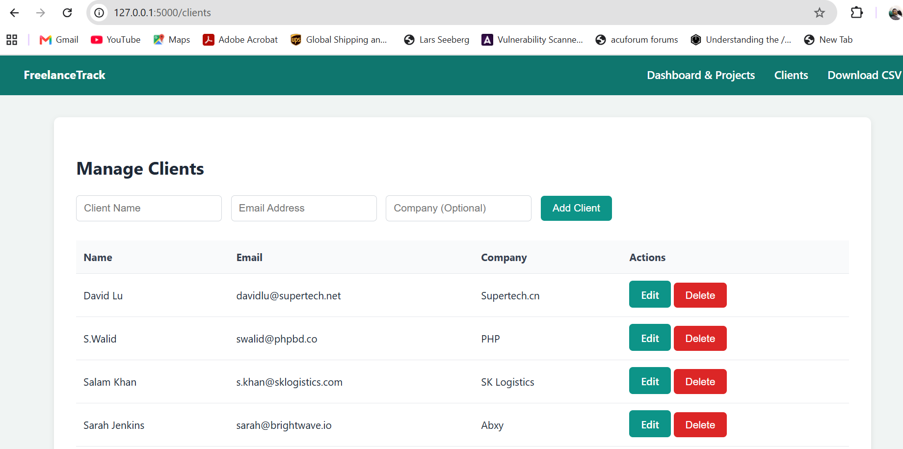

# FreelanceTrack - Client & Project Management Web App

A web application built with Python, Flask, and SQLite to help freelancers manage clients, track project deadlines and budgets, monitor payment status, and calculate total revenue.

## Features
- **Dashboard Overview:** Shows total clients, total projects, completed projects, total project value, and completed project value.
- **Client Management:** Add, view, edit, and delete client profiles.
- **Project Management:** Create projects linked to specific clients, set budgets and deadlines, update status (`Pending`, `In Progress`, `Completed`), and mark payments (`Paid` or `Unpaid`).
- **Search & Status Filter:** Search projects by title or client name, or filter projects by status.
- **Input Validation:** Validates required fields and budget amounts with clear error messages.
- **CSV Report Export:** Download all project records as a `.csv` file.

## Project Files
- `app.py` - Main Flask application and routes
- `database.py` - SQLite database connection, table creation, and dashboard statistics queries
- `tracker.db` - SQLite database file containing sample clients and projects
- `templates/` - HTML templates (`base.html`, `index.html`, `clients.html`, `edit_client.html`, `edit_project.html`)
- `static/style.css` - Custom CSS styling
- `screenshots/` - Application screenshots
- `requirements.txt` - Python dependencies

## Screenshots

### Dashboard Overview


### Projects List


### Clients Management


## Installation and Run Steps

1. 1. **Clone the repository:**
   ```bash
   git clone https://github.com/Saiful-Islam-Cyber/Freelancer--Client---Project-Management--Web--App.git
   cd Freelancer--Client---Project-Management--Web--App


2. **Install dependencies:**
   ```bash
   pip install -r requirements.txt
   ```

3. **Database setup:**
   - The `tracker.db` file is included in the repository with sample records.
   - To start with a blank database, delete `tracker.db` and run `app.py`—it will automatically generate a new database and tables.

4. **Run the application:**
   ```bash
   python app.py
   ```
   Open `http://127.0.0.1:5000` in your browser.


