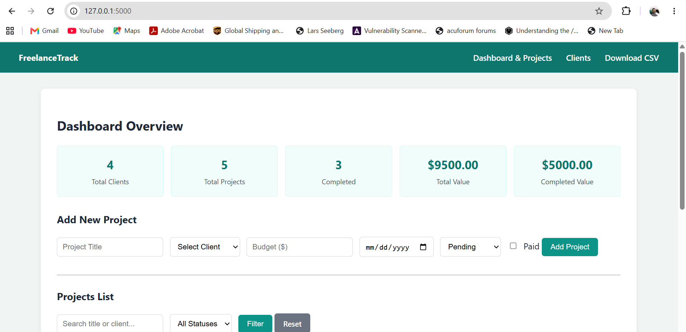
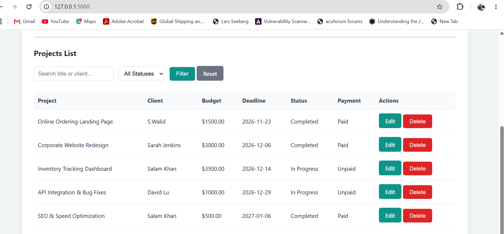

# FreelanceTrack – Client & Project Management Web App

A lightweight web application built with **Python**, **Flask**, and **SQLite** to help freelancers manage clients, track project budgets, monitor deadlines, and calculate completed revenue.

## Features
- **Dashboard Overview:** Live metrics showing total clients, total projects, completed projects, total project value, and completed value.
- **Client Management (CRUD):** Add, view, edit, and delete client profiles.
- **Project Management (CRUD):** Create projects linked to clients, set deadlines and budgets, track status (`Pending`, `In Progress`, `Completed`), and mark payments (`Paid`/`Unpaid`).
- **Search & Status Filtering:** Search projects by title or client name and filter by project status.
- **Input Validation:** Server-side validation with clear user feedback messages for missing fields or invalid numbers.
- **CSV Export (Bonus):** Download a formatted CSV report of all projects and payment statuses.

## Screenshots
### Dashboard & Metrics


### Projects List & Filters


## Tech Stack
- **Backend:** Python 3, Flask
- **Database:** SQLite3 (`sqlite3` standard library)
- **Frontend:** HTML5, Jinja2 Templates, Custom CSS

## Installation & Setup
1. **Clone the repository:**
   ```bash
   git clone <your-github-repo-url>
   cd <your-project-folder>
   ```

2. **Install dependencies:**
   ```bash
   pip install -r requirements.txt
   ```

3. **Database Setup:**
   - The repository includes a pre-populated `tracker.db` SQLite database with sample clients and projects.
   - If `tracker.db` is deleted, running `app.py` automatically runs `init_db()` in `database.py` to recreate the `clients` and `projects` tables.

4. **Run the application:**
   ```bash
   python app.py
   ```
   Open `http://127.0.0.1:5000` in your browser.
